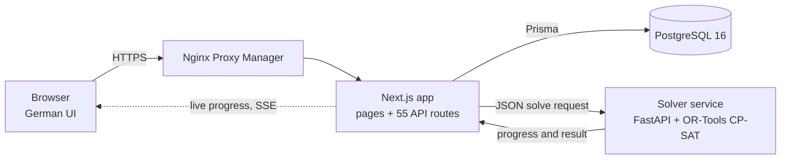

# SchichtMeister

Shift planning for a care home. A constraint solver builds a month's roster that
respects labour rules, contracts and qualifications, and the planner fine-tunes it
by hand, with every change checked against the same rules.

**Live demo:** https://sm.dendigital.de. Sign in with `demo@schichtmeister.local` /
`demo1234`. Visitors can change anything; the data resets every night. The interface
is in German.

## Background

SchichtMeister was built for a German care home with about 45 employees, where the
monthly roster was planned on paper and then retyped into Excel. A planner there has
to balance rest periods, full-time, part-time and mini-job contracts, the
qualifications each shift and care unit needs, and the staff's wishes. The app models
those real rules. It never went into production and is not finished (see
[Status](#status)).

## What it does

- **Generates a roster in one click.** A CP-SAT model (Google OR-Tools) plans early,
  late, night and leadership shifts across three care units. Hard rules are never
  broken; everything else is weighed as a goal. Details are in
  [How the solver works](#how-the-solver-works).
- **Shows the search live.** Progress streams to the browser while the solver runs.
  Several runs with different random seeds can race each other, and the best one wins.
  Cancelling keeps the best plan found so far, and after a dropped connection the runs
  that already finished aren't repeated.
- **Lets the planner steer.** Shifts, absences and days off can be fixed before
  generating, and the solver builds around them. Two strategies are available: cover
  every slot, or rather leave a slot empty than overload people. An admin can tune
  every weight.
- **Checks every hand edit.** A TypeScript rule engine re-checks the schedule after
  each change and flags problems by severity, so manual changes are held to the same
  rules as generated ones.
- **Views and history.** Month table with multi-cell editing, week, day timeline and
  per-employee views. Every regeneration and edit saves a version that can be restored.
- **Exports.** The whole roster as Excel or PDF, and a PDF plan per employee. German
  public holidays are built in.
- **Roles.** Admin, planner and a demo role. The admin tools cover users, solver
  weights, an activity log and a read-only database viewer that masks secrets.

## How the solver works

The app sends the solver one JSON request containing:

- every employee's contract, target hours, qualifications, units, absences, wishes
  and the last days of the previous month;
- the staffing rules per shift and unit;
- any fixed placements and the active weights.

The solver turns that into one yes/no decision per employee, day and shift, then adds
these rules.

**Hard rules**, never broken:

- One shift per day at most, and none on absences or blocked days.
- The minimum rest between shifts (11 hours by default).
- Limits on consecutive working days and nights, with the required rest afterwards.
- Every other weekend off.
- The mini-job monthly hour cap.
- Maximum staffing per shift.
- Qualification coverage wherever enough qualified staff are available.
- The rules for unit leaders' shifts.
- Fixed placements.

**Goals**, weighed against each other:

- Fill every shift. Understaffing costs a lot but is allowed, so there is always a
  plan to work with, even in an impossible month.
- Hit each person's target hours, with growing penalties for larger gaps and extra
  ones past overtime limits.
- Grant wishes, with strong wishes weighing more.
- Keep the worst deviation between colleagues as small as possible.
- Respect preferred shift types and shift mixes.
- Stay consistent across the month boundary: streaks, rest and weekends carried over
  from the previous month.

## Architecture



- **App:** Next.js 16 (App Router), React 19, MUI 7, NextAuth with credentials and JWT
  sessions, zod validation, Prisma 5 on PostgreSQL 16.
- **Solver:** Python 3.12, FastAPI, OR-Tools CP-SAT. It exposes `/solve`,
  `/solve-stream` (progress), `/cancel/{key}` and `/score` (a plain-text quality
  report).
- **Deployment:** one VPS with Docker Compose (`docker-compose.prod.yml`). A git push
  to the server runs `deploy/post-receive`, which applies migrations, rebuilds the
  containers and restarts them. The public demo uses the same demo data as a local
  install and resets to it every night (`deploy/demo-reset.sh`).

```
src/app/            pages and API routes
src/lib/planning/   rule engine that checks any schedule, hand edits included
src/lib/export/     Excel and PDF exports
solver/             solver service (FastAPI, OR-Tools CP-SAT)
prisma/             schema, migrations and seed data
deploy/             deploy hook and nightly demo reset
```

## Run it locally

You need Docker with Compose. In the cloned folder:

```bash
cp .env.example .env              # set POSTGRES_PASSWORD and NEXTAUTH_SECRET to random strings
docker compose up -d --build      # database, solver and app; the first build takes a few minutes
docker compose run --rm setup     # creates the tables and loads the demo data
```

Open http://localhost:3000 and sign in with `admin@schichtmeister.local` and the
password `admin`. The same password works for `planner@schichtmeister.local`, and the
demo login from the live site works too. Running `setup` again resets the demo data.

The demo data is the setup of a real care home: its shift profiles, staffing rules and
qualifications, 45 employees with their contracts, and plans for January to September
2026. The names are made up.

## Tests

```bash
npm ci && npm test          # 159 tests: rule engine, generation helpers, API routes
npm run lint && npm run typecheck
cd solver && pip install -r requirements.txt pytest httpx && pytest   # 16 tests, including a full solve
```

## Status

The project stopped before production, so parts of the original plan were never
built: employee self-service, the shift-swap workflow and
email notifications (only password resets send mail).

## How it was built

Built by Damian Miela; much of the code was written with Claude, Anthropic's AI coding
assistant, under my direction.

## License

All rights reserved. The code is public so you can read it; please ask before reusing
any of it.
